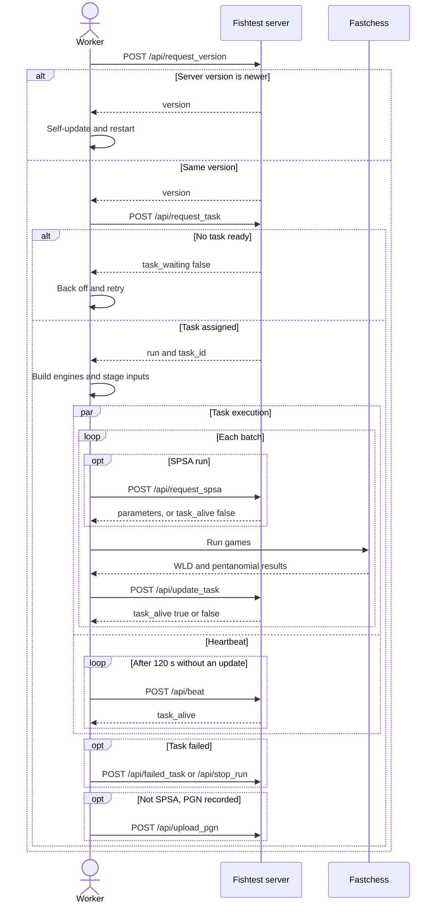

# Worker API Reference

The `/api` routes serve two clients: workers, which authenticate on every call
and drive a task from assignment to its last batch, and readers such as the
web UI and external tools, which need no account.

## Protocol invariants

- A successful response is a JSON object. `POST /api/actions` returns a JSON
  array.
- Every worker endpoint response carries `duration`, the seconds the server
  spent on the request.
- A request the handler refuses returns a non-2xx status with
  `{"error": "<path>: <message>", "duration": N}`, the message prefixed with
  the endpoint path:
  - 400: a body that is not JSON, a body the schema refuses, an unknown
    `run_id` or `task_id`, a missing field, a bad query parameter.
  - 401: a wrong username or password, a blocked or pending account, and every
    refused `stop_run`.
  - 404: a run, task, network or PGN a read-only endpoint cannot find.
- An outcome the run database decides returns HTTP 200 with a status flag:
  `"task_waiting": false` from `request_task`, `"task_alive": false` from
  `update_task`, `beat`, `request_spsa` and `failed_task`. An `info` or
  `error` string may come with it, worded by the scheduler and not prefixed
  with the path.
- A worker endpoint other than `/api/upload_pgn` called on a non-primary
  instance returns HTTP 503 with
  `{"error": "<path>: primary instance required", "duration": N}`.
- While the server shuts down, every request returns HTTP 503 with an empty
  `text/plain` body.
- Every GET route also answers HEAD.
- The protocol version is `WORKER_VERSION` in `api.py`. A worker whose own
  version is lower updates itself before it asks for work.

## Authentication

Every worker endpoint reads the credentials from the POST body: `password` at
the top level and `username` inside `worker_info`. `UserDb.authenticate()`
checks them.

- Wrong credentials: HTTP 401,
  `{"error": "/api/<endpoint>: Invalid username or password.", "duration": N}`.
  A blocked or pending account gets a message naming its state.
- A body that is not JSON: HTTP 400.

## Protocol lifecycle



1. **Version check**: `POST /api/request_version`. A newer server version
   makes the worker update itself and restart.
2. **Task request**: `POST /api/request_task`. The server assigns a task or
   returns `"task_waiting": false`, and the worker retries after a delay.
3. **Engine build**: the worker downloads the opening book, then builds both
   Stockfish binaries from source.
4. **Game execution**: the worker runs fastchess. For an SPSA run,
   `POST /api/request_spsa` fetches the parameters of each batch.
5. **Progress reporting**: `POST /api/update_task` sends the results so far
   after each batch. `"task_alive": false` stops the task.
6. **Heartbeat**: a daemon thread sends `POST /api/beat` once 120 seconds pass
   without an `update_task` or a beat for the current task. The server marks
   a task inactive when it has not heard from it for 360 seconds; its unplayed
   games go to the next task `request_task` creates.
7. **Failure**: the worker posts `POST /api/failed_task` when the task fails,
   and `POST /api/stop_run` when the run itself is broken (a wrong bench
   signature, a fastchess error).
8. **Games upload**: for a run that is not SPSA, `POST /api/upload_pgn` sends
   the recorded games once the task ends, whether it finished or failed.
9. **Loop**: the worker returns to step 2.

`POST /api/worker_log` posts a fastchess warning to the event log while games
run.

## Worker API paths

These 9 paths are the worker API (`WORKER_API_PATHS` in `api.py`). On a
non-primary instance all of them except `/api/upload_pgn` return HTTP 503:

```
/api/request_version
/api/request_task
/api/update_task
/api/beat
/api/request_spsa
/api/failed_task
/api/stop_run
/api/upload_pgn
/api/worker_log
```

## Request body

`/api/request_version` reads only the credentials:

```json
{ "password": "string", "worker_info": { "username": "string" } }
```

Every other worker endpoint validates the whole body against `api_schema`:

| Field | Required | Content |
|---|---|---|
| `password` | yes | the account password |
| `worker_info` | yes | the worker description below, every key required, no other key |
| `run_id` | no | the run, 24 hexadecimal digits |
| `task_id` | no | the task's index in the run; requires `run_id` |
| `stats` | no | game results, see [`update_task`](#post-apiupdate_task) |
| `spsa` | no | SPSA batch results, see [`update_task`](#post-apiupdate_task) |
| `message` | no | free text for `failed_task`, `stop_run` and `worker_log` |
| `pgn` | no | base64 of the gzip-compressed games, for `upload_pgn` |

With a `task_id`, the request's `worker_info.unique_key` and
`worker_info.username` must equal the task's.

`worker_info`:

| Key | Content |
|---|---|
| `uname` | operating system name and release |
| `architecture` | `platform.architecture()`, two strings |
| `concurrency` | cores the worker uses, a positive integer |
| `max_memory` | memory the worker may use, in MiB |
| `min_threads` | the fewest threads a task may ask for, a positive integer |
| `username` | the account name |
| `version` | the worker's `WORKER_VERSION` |
| `python_version` | three integers |
| `gcc_version` | the compiler version, three integers |
| `compiler` | `g++` or `clang++` |
| `unique_key` | the worker's UUID |
| `modified` | `true` when the worker's files differ from the release |
| `worker_arch` | the Stockfish architecture the worker builds for, or `unknown` |
| `ARCH` | the CPU features the engine reports |
| `nps` | the measured nodes per second, a non-negative number |
| `near_github_api_limit` | `true` when the worker is close to the GitHub API rate limit |

## Authenticated endpoints

### POST /api/request_version

Returns the worker protocol version: `{"version": N, "duration": N}`, where
`version` is `WORKER_VERSION`.

### POST /api/request_task

Assigns a task to the worker.

**Task assigned**:

```json
{
  "run": {
    "_id": "run_id",
    "args": { "...": "the run arguments, with book_sri when the book is known" },
    "my_task": { "num_games": 200, "start": 0, "stats": { "...": "..." } }
  },
  "task_id": 0,
  "duration": 0.05
}
```

**No task**: `{"task_waiting": false, "duration": N}`, with an `info` string
when the server is too busy or the chosen run needs no more games, and an
`error` string
when the worker is blocked, its name is already in use, or the account's
machine limit is reached.

### POST /api/update_task

Reports the results of the task so far. `stats` carries the cumulative
counts:

```json
{
  "wins": 10, "losses": 5, "draws": 15, "crashes": 0, "time_losses": 0,
  "pentanomial": [0, 1, 9, 4, 1]
}
```

The counts must agree with the pentanomial: wins, losses and draws add up to
twice the game pairs, and the win-loss difference and the draws follow from
the pairs. An SPSA run also sends `spsa`,
`{"wins", "losses", "draws", "num_games", "sig"}`, the batch's results, where
`num_games` is even and equals the sum of the three counts, and `sig` is the
signature `request_spsa` returned.

**Response**: `{"task_alive": true, "duration": N}` while the task runs, and
`"task_alive": false` once the task is finished, inactive or stopped, with an
`info` or `error` string where the server explains why.

### POST /api/beat

Keeps the task alive between updates.

**Response**: `{"task_alive": true | false, "duration": N}`.

### POST /api/request_spsa

Returns the parameters for the next SPSA batch:

```json
{
  "w_params": [{ "name": "string", "value": 0.0, "...": "the step values" }],
  "b_params": [{ "name": "string", "value": 0.0, "...": "the step values" }],
  "sig": 0,
  "task_alive": true,
  "duration": 0.01
}
```

For an inactive task: `{"task_alive": false, "info": "...", "duration": N}`.

### POST /api/failed_task

Marks the task failed and records `message` on the event log.

**Response**: `{"duration": N}`, or `{"task_alive": false, "info": "...",
"duration": N}` when the task is already inactive.

### POST /api/stop_run

Stops the run and records `message` on the event log. The account needs at
least 1000 CPU hours.

**Response**: `{"duration": N}`. The refusals return HTTP 401: an account
under 1000 CPU hours (the request is still logged, marked `(not authorized)`,
and the task is made inactive) and a run that is already finished.

### POST /api/upload_pgn

Stores the gzip-compressed games of the task, `pgn` in base64. The decoded
data must start with the gzip signature.

**Response**: `{"duration": N}`.

This endpoint runs on a non-primary backend and is outside
`PRIMARY_ONLY_WORKER_API_PATHS`.

### POST /api/worker_log

Records `message` on the event log. A `run_id` requires a `task_id`, so the
server can check that the worker holds that task.

**Response**: `{"duration": N}`.

## Read-only endpoints

These endpoints need no authentication.

### GET /api/active_runs

Returns every unfinished run as a JSON object keyed by run ID, without
`tasks`, `bad_tasks` and the SPSA parameter history.

### GET /api/finished_runs

Returns 50 finished runs per page, keyed by run ID.

| Parameter | Content |
|---|---|
| `page` | required, 1-based |
| `username` | only this submitter's runs |
| `success_only` | any non-empty value keeps only accepted runs |
| `yellow_only` | any non-empty value keeps only yellow runs |
| `ltc_only` | any non-empty value keeps only long time control runs |
| `timestamp` | a UNIX timestamp, 10 digits with optional fraction; keeps the runs updated since then |

### POST /api/actions

Returns up to 200 event-log entries matching the MongoDB filter in the JSON
body, in the collection's natural order. A body that is not a valid filter
returns `[]`. The response allows any origin.

### GET /api/get_run/{id}

Returns the run without `tasks`, `bad_tasks` and the SPSA parameter history.
The response allows any origin.

### GET /api/get_task/{id}/{task_id}

Returns one task. `task_id` is the task's index, or the index followed by
`bad` for a task in `bad_tasks`. The worker's `unique_key` is cut to its
first 8 characters and `remote_addr` is masked.

### GET /api/get_elo/{id}

Returns the run, stripped as `get_run` strips it, with the SPRT analysis under
`elo`. A run without SPRT returns `{}`.

### GET /api/calc_elo

Computes Elo from game counts.

| Parameter | Content |
|---|---|
| `LL`, `LD`, `DDWL`, `WD`, `WW` | pentanomial counts; take precedence over W/D/L |
| `W`, `D`, `L` | win, draw and loss counts |
| `elo0`, `elo1` | SPRT bounds, both or neither; each at most 10 in magnitude, `elo1` at least `elo0 + 0.5` |
| `elo_model` | `BayesElo`, `logistic` or `normalized` (default); read only with SPRT bounds |

Without SPRT bounds it returns `{"elo", "ci", "LOS"}`; with them, the SPRT
analysis with `alpha` and `beta` fixed at 0.05. At most 2^32 games.

### GET /api/nn/{id}

Counts a download of the network and redirects (HTTP 302) to
`<base>/nn/<id>`, where `<base>` is `FISHTEST_NN_URL`, or the request's own
scheme and host when the variable is unset.

### GET /api/pgn/{id}

Downloads the games of one task, `id` being `<run_id>-<task_id>.pgn`, served
with `Content-Encoding: gzip`.

### GET /api/run_pgns/{id}

Downloads the games of every task of a run as one gzip file. `id` must be
`<run_id>.pgn.gz`.

### GET /api/rate_limit

Returns the server's GitHub API rate limit.

## Validation

Request bodies are validated against vtjson schemas in `schemas.py`:

- `api_access_schema`: the credentials, `password` and
  `worker_info.username`; other keys are allowed.
- `api_schema`: the whole body of every worker endpoint except
  `request_version`.
- `gzip_data`: the decoded PGN upload starts with the gzip signature.

A failed validation returns HTTP 400.

## Adding a new API endpoint

1. Add the route in `api.py` with `@router.post(...)` or `@router.get(...)`.
2. Write the handler as an `async def` that wraps the request in an
   `ApiRequestShim` (`get_request_shim(request)` for a POST body), builds a
   `WorkerApi` or `UserApi` on it, and runs the method with
   `run_in_threadpool`.
3. Return a dict with `"duration"` (`GenericApi.add_time()`).
4. Refuse a request with `GenericApi.handle_error()`, which raises
   `HTTPException` with the error dict as its detail.
5. Add a vtjson schema in `schemas.py` if the endpoint accepts structured
   input.
6. Add a contract test in `tests/test_api.py`.
7. If the endpoint requires worker authentication, add its path to
   `WORKER_API_PATHS` in `api.py`.
