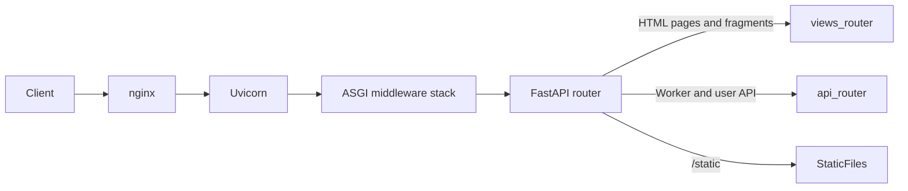

# Server Architecture

## What fishtest does

Fishtest is a distributed chess engine testing infrastructure. The server:

1. Accepts test submissions from developers (new Stockfish patches).
2. Assigns work units (tasks) to volunteer worker machines.
3. Collects game results and computes statistical tests (SPRT, ELO).
4. Publishes results through a web dashboard and a JSON API.

A single MongoDB instance is the system of record. All run state, user
accounts, action logs, and neural network metadata are stored there.

## Repository layout

```
server/
|-- pyproject.toml           -- Package metadata, dependencies
|-- uv.lock                  -- Locked dependency set
|-- fishtest/
|   |-- app.py               -- ASGI application factory, lifespan, middleware, routers
|   |-- api.py               -- API router (9 worker and 11 read-only endpoints)
|   |-- views.py             -- UI router (33 routes, data-driven dispatch,
|   |                          routing hub)
|   |-- views_helpers.py     -- Pure stateless helpers extracted from views.py
|   |-- views_actions.py     -- Actions-page helpers (row building, sorting, query strings)
|   |-- views_finished.py    -- Finished-runs page helpers (pagination, filtering)
|   |-- views_machines.py    -- Machines-page helpers (normalization, filter state)
|   |-- views_run.py         -- Run creation/modification helpers (validation, lifecycle)
|   |-- rundb.py             -- RunDb: run lifecycle, task distribution, caching
|   |-- userdb.py            -- UserDb: authentication, groups, registration
|   |-- actiondb.py          -- ActionDb: audit log
|   |-- workerdb.py          -- WorkerDb: worker blocking
|   |-- kvstore.py           -- KeyValueStore: key-value metadata (books, legacy usernames,
|   |                          worker runs, GitHub API cache, official master SHA)
|   |-- scheduler.py         -- Periodic task scheduler (primary instance only)
|   |-- schemas.py           -- vtjson validation schemas
|   |-- run_cache.py         -- In-memory run cache with dirty-page flush
|   |-- lru_cache.py         -- Generic LRU cache
|   |-- spsa_workflow.py     -- Pure classic SPSA lifecycle helpers
|   |-- spsa_handler.py      -- SPSA worker orchestration, request/update flow, history buffering
|   |-- github_api.py        -- GitHub integration (commit metadata, branch resolution)
|   |-- util.py              -- Shared utilities (formatting, validation helpers)
|   |-- constants.py         -- Shared constants (supported compilers and architectures)
|   |-- __init__.py          -- Minimal package init
|   |-- http/                -- HTTP support modules
|   |-- templates/           -- Jinja2 templates (54 files, .html.j2)
|   |-- static/              -- Static assets (JS, CSS, images)
|   `-- stats/               -- Statistical computation modules
|-- tests/                   -- Focused unit and HTTP contract tests
`-- utils/                   -- Operational scripts (backup, indexes, migration, nginx CIDR)
```

`views.py` remains the stable UI routing hub. The extracted `views_*.py` modules
hold domain logic, but route registration, `_dispatch_view`, and the request
shim stay centralized there. Each extracted `views_*.py` module keeps a matching
dedicated test file under `server/tests/`. User-facing route-family UI tests
reuse `ui_user_test_case.py` and stay grouped by route family or one focused
UI motif.

Classic SPSA server ownership is split deliberately. `spsa_workflow.py` holds
the pure classic SPSA helpers reused by the run form, the detail page, and the
worker lifecycle. `spsa_handler.py` stays attached to `RunDb` and owns the
stateful worker request/update path, flip packing, buffering, and history
timing.

### HTTP support modules (`server/fishtest/http/`)

```
http/
|-- __init__.py              -- Package init
|-- boundary.py              -- API request adapter (ApiRequestShim), session commit,
|                               template context builder (build_template_context)
|-- cookie_session.py        -- CookieSession class, secret key management, session helpers
|-- csrf.py                  -- CSRF token validation (CookieSession generates the token)
|-- dependencies.py          -- Request-state accessors (get_rundb, get_userdb, etc.), called directly
|-- errors.py                -- Centralized error handler installation (API/UI routing)
|-- jinja.py                 -- Jinja2 Environment, Jinja2Templates instance, static_url
|-- middleware.py            -- Pure ASGI middleware (5 middleware classes)
|-- open_graph.py            -- Open Graph metadata for shared links
|-- session_middleware.py    -- FishtestSessionMiddleware (itsdangerous cookie signing)
|-- settings.py              -- AppSettings (environment variable parsing)
|-- template_helpers.py      -- Jinja2 filters and global functions
|-- template_renderer.py     -- Template rendering helper (render_template_to_response)
|-- ui_cookies.py            -- Browser-readable UI preference cookies
|-- ui_errors.py             -- HTML error page rendering (404, 403)
`-- ui_pipeline.py           -- HTTP cache header application
```

### Statistical modules (`server/fishtest/stats/`)

```
stats/
|-- __init__.py
|-- LLRcalc.py               -- Log-likelihood ratio computation
|-- brownian.py              -- Brownian motion model for SPRT
|-- sprt.py                  -- Sequential probability ratio test
`-- stat_util.py             -- ELO calculation, SPRT_elo, get_elo
```

## Application startup

The entrypoint is `uvicorn fishtest.app:app`. The `create_app()` function in
`app.py` builds the FastAPI instance with a lifespan context manager that
handles startup and shutdown. OpenAPI docs (`/docs`, `/redoc`) are disabled
in production (`openapi_url` defaults to `None`). Set
`OPENAPI_URL=/openapi.json` to enable the full interactive API documentation
during development.

### Async concurrency model

The server uses Uvicorn (ASGI) with an async event loop. The event loop
accepts and dispatches HTTP connections; all blocking work runs in the
Starlette threadpool via `run_in_threadpool()`.

| Aspect | Description |
|--------|-------------|
| Concurrency model | Async event loop + threadpool (200 tokens, configurable) |
| Connection capacity | 9,400+ concurrent workers proven in production |
| Blocking I/O | Occupies a threadpool slot only during the blocking call |
| Memory per connection | Coroutine frame (~KBs), not a full thread stack |
| Overload behavior | Connections queue in the kernel backlog (`--backlog 16384`) |

All blocking work (MongoDB queries, file I/O, CPU-bound stats, GitHub API
calls) is offloaded to the threadpool. The event loop stays free to accept
new connections and dispatch lightweight work (session cookie signing, JSON
parsing, CSRF checks).

Application-level throttling (`task_semaphore(TASK_SEMAPHORE_SIZE)` +
`request_task_lock` in `rundb.py`) governs the scheduling critical path.
Both `THREADPOOL_TOKENS` and `TASK_SEMAPHORE_SIZE` are defined in
`http/settings.py`; see [Threading model](threading-model.md) for
the full analysis. Do **not** use Uvicorn's
`--limit-concurrency` flag -- it rejects excess connections with HTTP 503
instead of queuing them, which triggers exponential backoff in workers
(see [Deployment](deployment.md) for details).

### Startup sequence

1. `AppSettings.from_env()` reads `FISHTEST_PORT`, `FISHTEST_PRIMARY_PORT`
   and `OPENAPI_URL`; the result is stored as `app.state.settings`.
2. The threadpool limiter is set to `THREADPOOL_TOKENS`.
3. On the primary instance, `_require_single_worker_on_primary()` stops the
   startup when `UVICORN_WORKERS` (or `WEB_CONCURRENCY`) is an integer other
   than 1 (prevents duplicated scheduler side effects).
4. `RunDb(port, is_primary_instance)` is constructed in the threadpool. This
   connects to MongoDB and initializes all domain adapters (UserDb, ActionDb,
   WorkerDb, KeyValueStore).
5. Domain adapters are stored on `app.state` for request-scoped access:
   `app.state.rundb`, `app.state.userdb`, `app.state.actiondb`,
   `app.state.workerdb`.
6. The SIGUSR1 thread-dump handler is installed.
7. `schemas.legacy_usernames` is populated from the key-value store.
8. `gh.init()` initializes the GitHub API client on every instance; only the
   primary refreshes the official master SHA.
9. On the primary instance only:
   - `rundb.update_aggregated_data()` refreshes cached statistics.
   - `rundb.schedule_tasks()` starts the periodic scheduler.

### Shutdown sequence

1. `rundb._shutdown = True` -- signals middleware to reject new requests.
2. `asyncio.sleep(0.5)` -- brief drain period.
3. Scheduler is stopped (`rundb.scheduler.stop()`).
4. On primary: run cache is flushed, persistent data is saved.
5. A `system_event` action is logged when the instance has a port.
6. MongoDB connection is closed.

## Middleware stack

Middleware is installed in `create_app()` and executes in reverse installation
order (outermost first in the request path):

| Order | Middleware | Responsibility |
|-------|-----------|----------------|
| 1 | `FishtestSessionMiddleware` | Reads/writes signed session cookie (itsdangerous) |
| 2 | `RedirectBlockedUiUsersMiddleware` | Redirects blocked users to `/tests` (302) |
| 3 | `RejectNonPrimaryWorkerApiMiddleware` | Returns 503 for worker API on non-primary instances |
| 4 | `AttachRequestStateMiddleware` | Copies `app.state` handles to `request.state`; stamps `request_started_at` |
| 5 | `ShutdownGuardMiddleware` | Returns 503 for all requests during shutdown |
| 6 | `HeadMethodMiddleware` | Converts HEAD to GET and strips response body (RFC 9110 Section 9.3.2) |

All middleware classes are pure ASGI (`__call__(self, scope, receive, send)`).
None use Starlette's `BaseHTTPMiddleware`.

## Request flow

High-level request path:



- **Worker API**: `api_router` handles all `/api/*` endpoints. Worker
  endpoints require authentication: `password` and `worker_info.username` in
  the POST body.
- **UI**: `views_router` handles all HTML-rendering endpoints. Routes are
  registered from the `_VIEW_ROUTES` table via `_register_view_routes()`.
- **Static assets**: `StaticFiles` mount serves `/static/*`.

### htmx integration

UI templates load htmx 4.0.1 from CDN in `base.html.j2`. The server
remains fully server-rendered (Jinja2 + HTML responses). The test detail page
also loads a page-scoped diff renderer for the inline Diff panel. htmx adds
three capabilities without client-side rendering or a JavaScript build step:

| Capability | Mechanism |
|------------|-----------|
| Fragment polling | `hx-get` + `hx-trigger="every Ns"` fetches a fragment endpoint; server returns partial HTML |
| In-place content swap | `hx-get` + `hx-target` + `hx-swap="innerHTML"` replaces a page section (filters, pagination) |
| Out-of-band updates | `hx-swap-oob="innerHTML"` attributes in the response update multiple DOM elements in one response |

**Swapping and morphing.** A swap style of `innerHTML` replaces the children
of its target, so every node inside it is a new node. Anything the browser
attached to the old nodes goes with them, keyboard focus first of all: focus
on a link inside the panel returns to `<body>` on each tick. The two panels
that refresh on a timer, `#machines` on the homepage and `#tasks-content` on
the test detail page, use `innerMorph`, which patches the existing nodes in
place and keeps their identity. Both panels keep their filter form outside
the swap target either way.

**Response swapping.** htmx swaps every response whose status is not listed in
`htmx.config.noSwap`, which holds `204` and `304`. This server answers errors
with whole pages rather than partials sized for a swap target, so the `<body>`
element in `base.html.j2` carries
`hx-status:4xx:inherited="swap:none push:false"` and the `5xx` equivalent:
every descendant inherits them, and an error response neither swaps nor moves
the address bar.

**Settling.** An `htmx-config` meta tag sets `htmx.config.defaultSettleDelay`
to `0`.
Settling copies the attributes of each replaced element onto its replacement
and restores the response's own attributes a tick later, and it never rewrites
the `value` property of a focused input, so a filter field typed into while
its own subtree is swapped would keep the value it was served with. Nothing
styles the `htmx-settling` or `htmx-added` classes.

**Out-of-band-only responses.** A response whose body holds only out-of-band
elements leaves an empty fragment for the main swap, and htmx skips that swap:
`htmx.config.allowEmptySwapAfterOOB` is `false`. Emptying a swap target
requires a response that carries empty main content. The poll drivers that
send only out-of-band fragments, `#run-tables-poller`, `#live-elo-poller` and
`#tests-view-detail-poller`, declare `hx-swap="none"`. `#tests-stats-poller`
and the pollers that swap into themselves (see Polling lifecycle) receive
main content with every response.

The `<body>` policy stops the main content swap and, through `push:false`, the
history entry. htmx still applies out-of-band elements from the body and still
adopts the response's `<title>`, neither of them gated on the status. For any
status at or above 400, `application.js` therefore clears the response title
and empties the task list that carries the swaps on `htmx:before:swap`. A
failed request cannot move the address bar, rename the tab, or write an id
from an error page over live content.

**Dual-mode endpoints.** Several UI routes serve either a full page or an HTML
fragment from the same URL. The view handler calls `_is_hx_request(request)`,
then returns the appropriate template via the `_render_hx_fragment()` helper.
`HX-Request: true` opens the door, and three independent signals close it, each
rejecting the case it identifies: `HX-History-Restore-Request: true` for a back
navigation, `HX-Request-Type: full` for a swap scoped to the whole document,
and `Sec-Fetch-Mode: navigate` for a real top-level navigation. A request that
announces none of them is a fragment request.

`HX-Request-Type` states the scope of the swap: `partial` targets a region of
the current page, `full` replaces the document, which is what a boosted
navigation asks for. The check rejects `full` rather than requiring `partial`,
so a rename of that header degrades to treating every htmx request as a
fragment request, instead of swapping whole pages into every fragment target
on the site.

`_dispatch_view()` appends one `Vary` token per header the decision above
reads: `HX-Request, HX-History-Restore-Request, HX-Request-Type,
Sec-Fetch-Mode`, listed once in `FRAGMENT_REQUEST_HEADERS`. RFC 9111 section
4.1 requires the selecting header fields to be named there, or a shared cache
may hand a stored fragment to a request the server would answer with a whole
page.
UI GET responses also emit `Cache-Control`: the default is
`no-cache, private`, auth-sensitive pages use `no-store`, and explicit
route-level overrides such as `/tests/machines` can still set a short
`max-age`. This keeps dynamic cache policy server-authoritative and prevents
shared caches such as nginx `proxy_cache` from storing personalized UI
responses.

**Reverse-proxy cache boundary.** nginx should respect those application
headers for dynamic content and should not add `proxy_cache` in front of UI
routes. Aggressive proxy/browser caching remains appropriate for immutable
static assets only.

**Server-authoritative table state.** The htmx list pages (`/nns`,
`/contributors`, `/user_management`, `/workers/show`, `/tests/machines`,
`/actions`, `/tests/finished`) keep
sort, search, page, and view state in the URL and render the active control
state server-side on every response. Where the htmx target contains stateful
controls, the swapped boundary is the full content fragment, not just table
rows. The shared active-search debounce is projected into templates as
`htmx.input_changed_delay_ms`.

**Request coordination.** The poll-driven panels below a filter form,
`#machines` and `#tasks-content`, use `hx-sync` to name the form as their
request queue. The form
itself declares no `hx-sync`, so submitting it aborts an in-flight poll tick;
the poll and the sort/pagination links use `abort`, which drops a request while
another is in flight on that queue rather than pre-empting it.
Sort and pagination links carry their own query string and inherit nothing:
htmx applies an ancestor's attributes only where that ancestor marks them
`:inherited`, and a `GET` collects the enclosing form only when the requesting
element is the form itself.

**Fragment templates.** Fragment responses use standalone `.html.j2` files
(named `*_fragment.html.j2`) that do not extend `base.html.j2`;
`/rate_limits/server` returns its short fragment as inline HTML. This avoids
the need for block-level partial rendering and keeps fragments self-contained.
See [Templates](templates.md) for the full catalog.

**OOB table rows.** A `<tr>` cannot stand on its own in parsed HTML, so
fragments that update table bodies send their rows inside a `<template>`.
The `id` and `hx-swap-oob` attributes go on the `<template>` element itself,
never on an element inside it: htmx locates out-of-band elements with
`querySelectorAll`, which does not descend into template content, so a nested
`hx-swap-oob` is silently ignored. htmx strips the wrapper before the swap and
applies the rows to the live `<tbody>` named by the `id`.

**Polling lifecycle.** A poll that ends runs on a dedicated driver element
that carries the `hx-trigger="every Ns"` attribute and is not its own swap
target. htmx clears a poll interval only when its driver leaves the document,
so the lifecycle is expressed in the response body:

- **200** -- swap the response content and keep polling.
- **204** -- no content; htmx skips the swap and keeps polling.
- **200 with a driver-removing element** -- terminal state. The response
  includes `poll_stop_fragment.html.j2`, which renders
  `<div id="{poller_id}" hx-swap-oob="delete"></div>` and removes the driver.

The drivers are `#run-tables-poller`, `#live-elo-poller`,
`#tests-stats-poller`, and `#tests-view-detail-poller`.

Four pollers swap into the element that carries the trigger and poll for the
life of the page: `#machines` and `#tasks-content` (`innerMorph`; the tasks
panel renders the periodic trigger only for an unfinished run),
`#server_rate_limit` and `#pending-users-nav` (`innerHTML`).

The test detail page uses one visibility-aware OOB poller for live summary and
detail data:

- `/tests/view/{id}/detail` refreshes the ELO block, run status, active-worker
   totals, detail table, time block, compact chi-square block, and the
   embedded SPSA chart payload.

The merged detail poller uses `hx-swap="none"`, so the poller element stays
stable while htmx still applies the response's out-of-band section updates.
The tasks table keeps its own conditional `/tests/tasks/{id}` poller because it
has a separate shell/body + OOB-controls contract.

Run-list and detail polling intentionally use different data shapes. The
`/tests` and `/tests/user/{username}` run-table path rebuilds from
`aggregate_unfinished_runs()` and the lightweight unfinished-run query, which
omits `tasks`, `bad_tasks`, and `args.spsa.param_history`. Detail routes use
full run data via `get_run()` and the dedicated tasks poller.

**Visibility-aware polling policy.** Every periodic htmx poller follows a
three-part trigger policy:

1. A periodic trigger gated on `document.visibilityState === 'visible'`,
   written `every[<condition>] Ns`, the form htmx parses natively; the
   templates use no other spelling.
2. An immediate focus-return trigger using
   `visibilitychange[document.visibilityState === 'visible'] from:document`.
3. Section-scoped pollers (machines, tasks) additionally gate on the
   section's expanded state (`classList.contains('show')`).

This ensures background tabs do not generate server load and that
returning to the tab produces an immediate refresh.

## Primary instance model

Multiple Uvicorn instances run behind nginx (ports 8000-8003). Exactly one is
designated the **primary** via the `FISHTEST_PRIMARY_PORT` environment variable.

### Primary responsibilities

- Periodic scheduler: buffer flush, cache cleanup, dead-task scavenging,
  throughput, nps and games-per-minute updates, run and data-structure
  validation, worker-map cleanup, book updates, and the official master SHA
  refresh.
- Aggregated data updates.
- The official master SHA refresh at startup, and the GitHub API cache save at
  shutdown.
- Run cache flush and persistent data save on shutdown.
- The worker API, except `/api/upload_pgn`, and the run actions
  (`/tests/run`, `modify`, `stop`, `approve`, `purge`, `delete`).

### Secondary instances

- Serve UI pages, the read-only `/api/*` endpoints and `/api/upload_pgn`.
- Worker API requests other than `/api/upload_pgn` return 503 (via
  `RejectNonPrimaryWorkerApiMiddleware`), and so do the run actions.
- nginx routes worker API traffic to the primary and PGN uploads to their own
  instance; the rest is distributed across the instances.

## Signals

| Signal | Behavior |
|--------|----------|
| SIGINT / SIGTERM | Uvicorn initiates graceful shutdown -> lifespan cleanup runs |
| SIGUSR1 | Dumps all thread stacks to stderr via `faulthandler.register()` |

To trigger a thread dump on a systemd-managed instance, run `sudo systemctl kill -s SIGUSR1 fishtest@8000`.

During shutdown, `ShutdownGuardMiddleware` rejects new requests with HTTP 503.

## Core domain adapters

These are not HTTP modules. They encapsulate business logic and MongoDB access.

| Adapter | Module | Responsibility |
|---------|--------|----------------|
| `RunDb` | `rundb.py` | Run lifecycle, task assignment, result aggregation, run cache |
| `UserDb` | `userdb.py` | User CRUD, authentication, group membership |
| `ActionDb` | `actiondb.py` | Audit trail for user and system actions |
| `WorkerDb` | `workerdb.py` | Worker ban list management |
| `KeyValueStore` | `kvstore.py` | Lightweight key-value pairs in MongoDB |
| `Scheduler` | `scheduler.py` | Periodic background tasks on primary instance |

A single `RunDb` instance is created per process at startup and stored on
`app.state.rundb`. It owns all other adapters (`rundb.userdb`, `rundb.actiondb`,
`rundb.workerdb`, `rundb.kvstore`).

## Validation

vtjson is the sole validation layer. The `schemas.py` module defines the
repository's vtjson schemas for plain Python dict validation. Schemas are used
in:

- API endpoints (request body validation).
- Domain adapters (run, user, action document validation before MongoDB writes).
- Form input validation (username format, worker name format).

When raw form input and persisted document data intentionally have different
contracts, fishtest uses different vtjson schemas for those boundaries.
Raw-input schemas may be broader than the persisted-data schema, while the
persisted schema describes the canonical stored form validated before MongoDB
writes.

For contributor-facing vtjson rules and schema-change guidance, see
[Development](development.md).

No Pydantic models are used anywhere in the codebase.

## Framework usage: FastAPI as a thin wrapper

This project uses FastAPI as a thin routing convenience layer on top of
Starlette. The FastAPI-exclusive features in use are:

1. **`FastAPI()`** -- the application class (inherits `starlette.Starlette`).
2. **`APIRouter`** -- decorator-style route registration and data-driven
   `add_api_route()`.
3. **Exception handlers** -- two fallback handlers from
   `fastapi.exception_handlers`.
4. **`HTTPException` and `RequestValidationError`** -- raised by the API and
   CSRF code, and handled by `install_error_handlers`.

The following FastAPI features are **not used**:

- Pydantic request/response models (`BaseModel`, `response_model`).
- Dependency injection (`Depends()`) in route signatures.
- Parameter declarations (`Body`, `Query`, `Path`, `Header`, `Cookie`).
- Security schemes (`OAuth2`, `HTTPBasic`, `APIKey`).

All middleware is pure ASGI (Starlette pattern). Session handling, CSRF
protection, authentication, and request validation use custom
implementations -- not FastAPI's built-in machinery.

Contributors should not expect Pydantic, DI, or security scheme patterns
in this codebase. When importing classes that FastAPI re-exports from
Starlette (`Request`, `Response`, `JSONResponse`, `StaticFiles`, etc.),
prefer importing from `starlette` directly.

## Error handling

Error handlers are installed via `install_error_handlers(app)` in `app.py`.
They route errors differently based on the request path:

| Path prefix | HTTP 404 | HTTP 401/403 | Validation error | Unhandled exception |
|-------------|----------|--------------|------------------|---------------------|
| `/api/*` (worker) | JSON `{"error": "...", "duration": N}` | JSON | 400 `{"error": "<path>: invalid request", "duration": N}` | 500 `{"error": "<path>: Internal Server Error", "duration": N}` |
| `/api/*` (other) | the handler's `{"error": "...", "duration": N}`; `{"detail": "Not Found"}` for an unknown path | JSON | 400 `{"detail": "Invalid request", "errors": [...]}` | 500 `{"detail": "Internal Server Error"}` |
| UI routes | HTML 404 page (Jinja2) | the login page with HTTP 403 and a "Please login" message | FastAPI's 422 JSON | Plain text 500 |

A handler's error dict is returned as the response body, so worker API errors
carry `duration`. The one exception is shutdown: `ShutdownGuardMiddleware`
answers every path with an empty 503.
