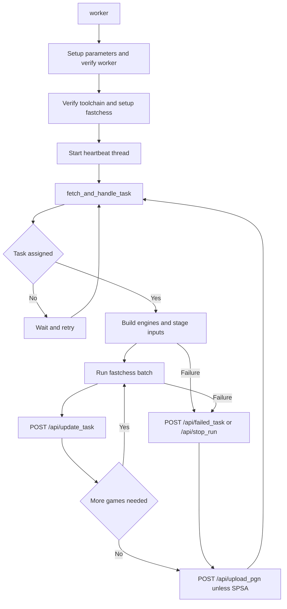

# Worker architecture

## Overview

The worker is a standalone Python application (Python >= 3.8) that runs on
contributor machines. It fetches testing tasks from the fishtest server,
compiles Stockfish from source, runs games via fastchess, and reports
results back.

Source files:

| File | Purpose |
|------|---------|
| `worker/worker.py` | Main control loop, configuration, signal handling, heartbeat |
| `worker/games.py` | Engine compilation, game execution, fastchess output parsing |
| `worker/updater.py` | Self-update mechanism |
| `worker/sri.txt` | SRI hashes of the three files above, checked against the server's copy |

The worker writes its configuration to `worker/fishtest.cfg` on first start;
the file is not part of the repository.

## Constants

| Constant | Value | Location |
|----------|-------|----------|
| `WORKER_VERSION` | the protocol version the server compares | `worker.py` |
| `FASTCHESS_SHA` | the fastchess commit the worker builds | `worker.py` |
| `HTTP_TIMEOUT` | 30.0 s | `worker.py`, `games.py` |
| `INITIAL_RETRY_TIME` | 15.0 s | `worker.py` |
| `MAX_RETRY_TIME` | 900 s (15 min) | `worker.py` |
| `THREAD_JOIN_TIMEOUT` | 15.0 s | `worker.py` |
| `UPDATE_RETRY_TIME` | 15.0 s | `games.py` |
| `FASTCHESS_KILL_TIMEOUT` | 15.0 s | `games.py` |
| `MIN_GCC_MAJOR.MINOR` | 10.2 | `worker.py` |
| `MIN_CLANG_MAJOR.MINOR` | 11.0 | `worker.py` |

## Control flow

High-level worker control flow:



### `worker()` -- entry point

1. Acquire a file lock (`fishtest_worker.lock`) to prevent multiple instances
   in the same directory.
2. Install signal handlers (SIGINT, SIGTERM, SIGQUIT, SIGBREAK).
3. Call `setup_parameters()` to read/validate `fishtest.cfg`, probe hardware,
   parse CLI arguments, validate credentials, and write config back.
4. Write SRI hashes (`sri.txt`).
5. If `--only_config` was passed, exit.
6. Create `testing/`.
7. Verify the worker version with the server (may trigger self-update).
8. Verify the toolchain (`make`, `strip`).
9. Build fastchess from source if not already cached, and run its tests.
10. Verify worker integrity via remote SRI comparison.
11. Assemble `worker_info` (username, concurrency, compiler, UUID, and the
    `worker_arch` that Stockfish's `get_native_properties.sh` reports).
12. Start the heartbeat thread (daemon).
13. Enter the main loop: call `fetch_and_handle_task()` repeatedly, and stop
    when `fish.exit` exists in the worker directory.

### `fetch_and_handle_task()`

1. Re-verify worker version (may trigger self-update).
2. Clean up old files in `testing/`.
3. Check remaining GitHub API calls.
4. POST `/api/request_task` to get a task assignment.
5. If a task is assigned, call `run_games()`.
6. On exception, POST `/api/stop_run` for a `RunException` and
   `/api/failed_task` for any other.
7. For a run that is not SPSA, upload the recorded games via POST
   `/api/upload_pgn` when the PGN file is non-empty and its CRC matches,
   whether the task finished or failed.

### `run_games()`

1. Set up `result` dict with existing stats (supports resume).
2. Download the opening book if missing or corrupted (SRI check).
3. Build both `new` and `base` engines from source via `setup_engine()`.
4. Download neural networks via `establish_validated_net()`.
5. Verify engine bench signatures.
6. Compute NPS, derive CPU scaling factor.
7. Reject if the machine is too slow.
8. Adjust time control based on CPU scaling factor.
9. Construct the fastchess command line.
10. Call `launch_fastchess()` in a loop (one iteration per batch for SPSA,
    one call for SPRT/NumGames).

### `launch_fastchess()`

1. For SPSA: POST `/api/request_spsa` to get tuning parameters.
2. Insert SPSA option values into the fastchess command line (stochastic
   rounding).
3. Start fastchess as a subprocess.
4. Call `parse_fastchess_output()` to monitor stdout/stderr.
5. On exit, send SIGINT to fastchess and wait for graceful shutdown.

### `parse_fastchess_output()`

1. Read fastchess stdout/stderr via background threads feeding a queue.
2. Parse WLD and pentanomial results from fastchess output blocks.
3. Detect crashes, time losses, and fastchess errors.
4. After each batch of games, POST `/api/update_task` with accumulated stats.
5. Respect `task_alive` flag from server response.
6. Enforce a time limit (`tc_limit`).

## Heartbeat

A daemon thread sends POST `/api/beat` once 120 seconds pass without a
successful `update_task` or beat, and skips the beat while no task is
assigned. If the server responds with `task_alive: false`, the current task
is abandoned.

## Signal handling

| Signal | Behavior |
|--------|----------|
| SIGINT | Set `current_state["alive"] = False`, raise `FatalException` |
| SIGTERM | Same as SIGINT |
| SIGQUIT | Same as SIGINT (Unix only) |
| SIGBREAK | Same as SIGINT (Windows only) |

A `fish.exit` file in the worker directory stops the worker. It is checked
after every successful `update_task`, which ends the task with
`WorkerException("Task stopped by 'fish.exit'.")` and posts `failed_task`,
and after every task. The worker removes the file on exit.

## Configuration file

File: `worker/fishtest.cfg` -- INI format, managed by `ConfigParser`.

### Sections and options

```ini
[login]
username = myuser
password = mypassword

[parameters]
protocol = https                          ; http or https
host = tests.stockfishchess.org
port = 443
concurrency = max(1,min(3,MAX-1))         ; expression using MAX = cpu_count
max_memory = MAX/2                        ; expression using MAX = total_ram_MiB
uuid_prefix = _hw                         ; _hw = hardware-derived, or alphanumeric
min_threads = 1                           ; reject tasks with fewer threads
fleet = False                             ; True = quit on error or empty queue
global_cache =                            ; shared cache path for multi-worker setups
compiler = g++                            ; g++ or clang++

[private]
hw_seed = 3418512882                      ; random seed for UUID derivation
```

The `concurrency` and `max_memory` fields accept expressions with `MAX` as a
variable and `min`/`max` as functions. They are evaluated at startup.

On every start the worker also:

- sets the port to 80 for `http` on 443, and to 443 for `https` on 80;
- lowers `concurrency` until an STC test fits in `max_memory`, and refuses
  to start when `max_memory` cannot hold one;
- removes sections and options it does not know.

Every `[parameters]` option has a command line flag (e.g., `--concurrency`,
`--max_memory`, `--fleet`), and the `[login]` values are the positional
`USERNAME PASSWORD`. `[private] hw_seed` has no flag. A flag's value is
written back to `fishtest.cfg`, so it persists to later starts.

## Command line flags

Usage: `python worker.py [USERNAME PASSWORD] [OPTIONS]`

Each flag defaults to the value in `fishtest.cfg`; the defaults below are
those of a first start.

| Flag | Short | Type | Default | Description |
|------|-------|------|---------|-------------|
| `--protocol` | `-P` | `{http,https}` | `https` | Protocol for server communication |
| `--host` | `-n` | string | `tests.stockfishchess.org` | Server hostname |
| `--port` | `-p` | int | `443` | Server port |
| `--concurrency` | `-c` | expression | `max(1,min(3,MAX-1))` | Max cores to use (`MAX` = cpu_count) |
| `--max_memory` | `-m` | expression | `MAX/2` | Max memory in MiB (`MAX` = total RAM) |
| `--uuid_prefix` | `-u` | string | `_hw` | UUID prefix (`_hw` = hardware-derived) |
| `--min_threads` | `-t` | int | `1` | Reject tasks with fewer threads |
| `--fleet` | `-f` | `{False,True}` | `False` | Quit on error or empty queue |
| `--global_cache` | `-g` | path | (empty) | Shared cache directory for multi-worker setups |
| `--compiler` | `-C` | a detected compiler | `g++` when usable, else the first detected | Compiler for engine builds |
| `--only_config` | `-w` | flag | -- | Write config and SRI hashes, then exit |
| `--no_validation` | `-v` | flag | -- | Skip username/password validation with server |

The `concurrency` and `max_memory` flags accept expressions using `MAX` as
a variable and `min`/`max` as functions.

## Self-update mechanism

When `verify_worker_version()` learns from the server that a newer version
exists:

1. `updater.py:update()` downloads the master branch zip from GitHub.
2. Extracts the `worker/` directory to a temp folder.
3. Verifies SRI hashes of the downloaded files.
4. Replaces the local worker files with the new ones.
5. Renames `testing/` to `_testing_<timestamp>` and migrates cached files.
6. Calls `do_restart()` which uses `os.execv()` to replace the current
   process with a fresh invocation.

## Engine build pipeline

`setup_engine()` in `games.py`:

1. Check if a cached engine binary exists in `testing/` (keyed by SHA +
   compiler version + environment hash).
2. If cached and healthy (verified by running bench), return the cached path.
3. Otherwise, download the source zip from GitHub (with global cache support).
4. Extract, download default neural networks from source headers.
5. Determine the best CPU architecture target via `find_arch()`.
6. Run `make profile-build` (or `make build` for Apple Silicon).
7. Strip the binary.
8. Move to `testing/` with the canonical name.

## Compiler detection

`detect_compilers()` probes `g++` and `clang++` by running them with
`-E -dM -` and parsing version macros. It rejects:

- g++ < 10.2
- clang++ < 11.0
- clang++ masquerading as g++
- clang++ without `llvm-profdata`

## UUID generation

Each worker instance gets a unique key:
`uuid_prefix[:8] + uuid4()[8:]`

When `uuid_prefix = _hw`, the prefix is derived from:
`hw_seed XOR fingerprint(machine_id) XOR fingerprint(worker_path)`

Machine ID sources: `/etc/machine-id`, then `/var/lib/dbus/machine-id`
(Linux), registry `MachineGuid` (Windows), `ioreg IOPlatformExpertDevice`
(macOS).

## Fleet mode

When `fleet = True`, the worker exits immediately if:
- No tasks are available
- An error occurs during task execution
- The server is unreachable

This allows fleet orchestrators to spin workers up/down based on queue depth.

## Global cache

When `global_cache` points to an existing directory, multiple workers on the
same machine share downloaded artifacts (source zips, fastchess zips, neural
networks). Writes use atomic `link()` to avoid partial-file races.

## File management

`trim_files()` runs before each task to clean up old files in `testing/`:

| Pattern | Keep | Expiration |
|---------|------|------------|
| `fastchess` | 1 | never |
| `stockfish-*-old` | 0 | immediately, during a self-update only |
| `stockfish-*` | 50 | 30 days |
| `nn-*.nnue` | 10 | 30 days |
| `results-*.pgn` | 10 | 30 days |
| `*.epd` | 4 | 365 days |
| `*.pgn` | 4 | 365 days |

Files are sorted by access time; the most recently accessed are preserved.

## API endpoints used by the worker

Every fishtest endpoint except `/api/nn/{id}`, a plain GET, takes a
JSON-encoded POST body with `password` and `worker_info` fields. Responses
are JSON dicts that may contain an `error` key.

### Fishtest server endpoints

| Endpoint | Method | Phase | Purpose |
|----------|--------|-------|---------|
| `/api/request_version` | POST | Setup | Check worker version, trigger update |
| `/api/request_task` | POST | Setup | Request a task assignment |
| `/api/nn/{id}` | GET | Setup | Download a neural network file |
| `/api/update_task` | POST | Main loop | Report game results (batch updates) |
| `/api/request_spsa` | POST | Main loop | Get SPSA tuning parameters |
| `/api/beat` | POST | Heartbeat | Keep the task alive after 120 s without an update |
| `/api/failed_task` | POST | Finish | Report task failure |
| `/api/stop_run` | POST | Finish | Request early run termination |
| `/api/upload_pgn` | POST | Finish | Upload compressed PGN game records |
| `/api/worker_log` | POST | Main loop | Log a fastchess warning on the server |

### External endpoints

| Endpoint | Method | Purpose |
|----------|--------|---------|
| `https://api.github.com/rate_limit` | GET | Check remaining API quota |
| `https://api.github.com/repos/Disservin/fastchess/zipball/{sha}` | GET | Download fastchess source |
| `https://api.github.com/repos/{user}/{repo}/zipball/{sha}` | GET | Download engine source |
| `https://raw.githubusercontent.com/official-stockfish/books/master/<book>.zip` | GET | Download an opening book |
| `https://api.github.com/repos/official-stockfish/books/contents/<book>.zip?ref=master` | GET | Download an opening book (fallback) |
| `https://github.com/official-stockfish/fishtest/archive/master.zip` | GET | Download the worker for a self-update |

## Exception hierarchy

| Exception | Effect |
|-----------|--------|
| `FatalException` | Post `failed_task`, upload the games, stop the worker |
| `RunException` | Stop the current run (POST `/api/stop_run`), continue to next |
| `WorkerException` | Fail the current task, continue to next |
| any other exception | Post `failed_task` with the traceback, stop the worker |

`WorkerException.__new__` forwards existing `WorkerException` subclass
instances (including `FatalException`) unchanged, preventing exception type
downgrade during re-wrapping.

## Logging

The worker writes `api.log` in its install directory, beside `worker.py`.
Each API call records the server-side and worker-side latency, and each task
start records the run, the task and its size:

```
2025-01-15 12:00:00.123456+00:00 : 1.23 ms (s)  45.67 ms (w)  https://tests.stockfishchess.org:443/api/update_task
```

On self-update, the log is rotated to `api.log.previous`.

## Developer: regenerating SRI hashes

When modifying SRI-monitored files (`worker.py`, `games.py`, `updater.py`),
the `sri.txt` file must be regenerated before committing. Use the
`--only_config` flag to write the config and update SRI hashes without
starting the worker:

```bash
cd worker
uv run worker.py a a --only_config --no_validation
```

The dummy `a a` arguments satisfy the positional username/password
parameters. `--no_validation` skips server contact. The command needs a
usable compiler (g++ >= 10.2 or clang++ >= 11.0), writes updated hashes to
`worker/sri.txt` and `worker/fishtest.cfg`, and exits. Delete the generated
`fishtest.cfg` afterwards: the worker tests expect none.
